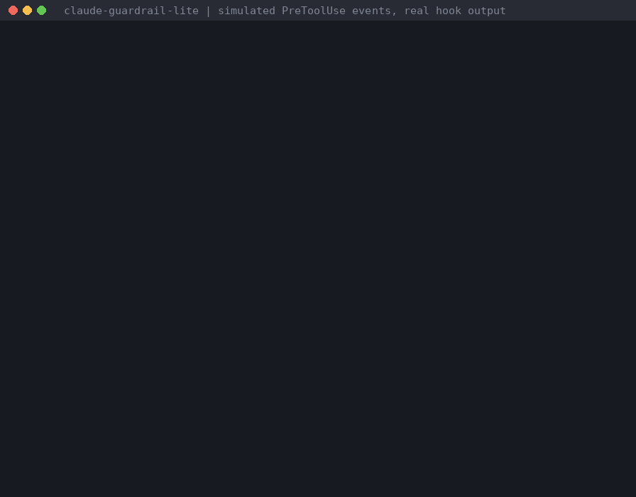

# claude-guardrail-lite (free, MIT)

A deny-first PreToolUse hook for Claude Code. Risky tool calls are **denied** until a human approves that exact call from their own terminal with a one-time code. Every decision is written to a local JSONL receipt log.

Claude Code 的「先擋再核准」PreToolUse hook。高風險指令一律先 **deny**，人類在自己的終端機輸入一次性核准碼後才放行，每次決策都留一筆本機 JSONL 收據。



<sub>The demo pipes simulated PreToolUse JSON into the hook by hand; every line of output is real (`docs/demo-transcript.txt`). It is not a recording of a live Claude Code session. 示範是手動把模擬的 PreToolUse 事件送進 hook，輸出都是實際執行結果，不是 Claude Code 實機錄影。</sub>

> **Beta (v0.1.1).** Tested by replaying simulated PreToolUse events, not yet recorded end to end in a live Claude Code session by the author. Please run the self-check below and report anything odd in Issues. **This is a regex guardrail, not a sandbox.**
> **Beta（v0.1.1）**：以模擬的 PreToolUse 事件測試，作者尚未在真實 Claude Code session 中錄下完整流程。裝好後請跑下面的自我檢查，有問題請開 Issue。**這是 regex 護欄，不是沙箱。**

## What the lite edition covers / 免費版涵蓋範圍

| id | Blocks / 擋什麼 |
|---|---|
| `git-push-protected` | `git push` with `--force`/`-f`/`--force-with-lease`/`+branch`, or to main/master/production/prod (also `git -C dir push`) |
| `rm-recursive-force` | `rm -rf`, `rm -fr`, `rm -r -f`, `rm --recursive --force` |
| `claude-settings` | edits to `.claude/settings*.json` (Edit/Write, or shell `>`, `tee`, `sed -i`, `cp`, `mv`, `rm`), so the agent can't switch the hook off |
| `self-protect` | any agent command mentioning `cg-approve` or `.claude-guardrail`, and Edit/Write into `~/.claude-guardrail/`. **Cannot be approved.** |

**Full pack (US$19, one-time):** adds `git reset --hard`/`clean -f`/`branch -D`, ORM force/reset commands (Prisma, Drizzle, Rails, Django, Sequelize), `terraform apply/destroy`, `pulumi up/destroy`, `kubectl delete`, `helm uninstall`, `DROP`/`TRUNCATE`/`DELETE` without `WHERE`, `.env` writes, a unit-test suite, and a commercial license. [Get the full pack](https://buy.polar.sh/polar_cl_Y93JwF9WRZO9j6w2v0tJJ5xAqwKJGnuufCWC72QKCm0?utm_source=github&utm_medium=readme&utm_campaign=lite).
完整版（US$19 一次買斷）另含上述規則、單元測試與商業授權。

## Why not `"ask"` / 為什麼不用 `"ask"`

Several users report in the still-open [anthropics/claude-code#89561](https://github.com/anthropics/claude-code/issues/89561) that a PreToolUse `"ask"` let the tool call run with no prompt (mostly in auto mode; one report in default mode). In the same thread, `"deny"` from the same hook was enforced, and Claude Code's hooks reference documents `"deny"` as preventing the tool call. This hook only returns `deny` or stays silent, so it does not depend on `"ask"`.

多位使用者在仍未關閉的 #89561 回報：hook 回 `"ask"` 時，工具呼叫沒有跳確認就執行了（多數在 auto 模式，也有一則在 default 模式）。同一串裡，同一個 hook 回 `"deny"` 有被執行；官方文件也寫 `"deny"` 會阻止該次呼叫。本 hook 只回 `deny` 或不表態，不依賴 `"ask"`。

## Install / 安裝

Requires `python3` 3.8+ (stdlib only), macOS or Linux. / 需要 `python3` 3.8 以上，macOS 或 Linux。

```bash
git clone https://github.com/nr0225/claude-guardrail-lite && cd claude-guardrail-lite
./install.sh          # copy files, print the settings.json snippet / 複製檔案並印出設定片段
./install.sh --apply  # also merge the hook into ~/.claude/settings.json (backup kept) / 同時寫入設定（會先備份）
```

Restart Claude Code and run `/hooks` to confirm `cg-guard` is listed. Optional on Claude Code v2.1.295+: add `"onFailure": "block"` to the hook entry so a hook that cannot start or times out blocks instead of allowing.
重開 Claude Code，輸入 `/hooks` 確認看得到 `cg-guard`。Claude Code v2.1.295 以上可在這個 hook 加 `"onFailure": "block"`，hook 跑不起來或逾時時也會擋下。

### Self-check / 自我檢查 (in your own terminal / 在你自己的終端機)

```bash
echo '{"tool_name":"Bash","tool_input":{"command":"git push origin main"},"permission_mode":"auto"}' \
  | python3 ~/.claude-guardrail/bin/cg-guard
# expect permissionDecision "deny" and code 8888B4 / 應看到 deny 和核准碼 8888B4
```

Then ask Claude Code to run `git push --dry-run origin main`; it should be denied with a code.
再請 Claude Code 執行 `git push --dry-run origin main`，應該被擋並顯示核准碼。

## Flow / 使用流程

1. Claude tries `git push origin main` and is denied with a code such as `8888B4`. / Claude 想 push 到 main，被擋並拿到核准碼。
2. In **your own** terminal: `cg-approve 8888B4`, then retype the code. / 你在**自己的**終端機執行 `cg-approve 8888B4`，再輸入一次確認。
3. Tell Claude to retry the identical command. It passes once; the code is spent (valid 10 minutes). / 叫 Claude 重試完全相同的指令，放行一次後核准碼失效（10 分鐘內有效）。
4. `cg-receipts` shows the last 20 decisions. / `cg-receipts` 看最近 20 筆。

## Limitations / 限制

- Stops accidents, not a determined adversary. Obfuscated commands (variables, base64, odd quoting, globs) can slip past regexes. / 防手滑，不防刻意混淆。
- `cg-approve` needs a real terminal (`/dev/tty`) and any agent command mentioning it is denied, but this is not cryptographic isolation. / `cg-approve` 需要真正的終端機，但不是密碼學等級的隔離。
- Bare `git push` while on main is not caught (the branch is not in the command text); pair with GitHub branch protection. / 沒寫分支的 `git push` 擋不到，請搭配 branch protection。
- Only Bash, Edit, Write and MultiEdit are checked. / 只檢查這四種工具。
- Missing rules, malformed input or an internal error answer `deny`. If `python3` cannot start or the hook times out, Claude Code continues by default (see `onFailure` above). / 規則不見、輸入錯誤、內部錯誤都回 deny；python3 跑不起來或逾時則預設放行。
- Native Windows is not supported; WSL is untested. / 不支援原生 Windows，WSL 未測。

## Uninstall / 解除安裝

Run in your own terminal (the agent is blocked from `~/.claude-guardrail` on purpose): remove the `cg-guard` entry from `hooks.PreToolUse` in `~/.claude/settings.json`, then `rm ~/.local/bin/cg-approve ~/.local/bin/cg-receipts` and `rm -r ~/.claude-guardrail`.

## License

MIT, see [LICENSE](LICENSE). Not affiliated with Anthropic; "Claude" and "Claude Code" are trademarks of Anthropic.
